# 🛡️ AWS Site-to-Site VPN Connectivity Inspector & Audit Dashboard

> **Enterprise Site-to-Site VPN End-to-End Diagnostic & Executive Reporting Tool**  
> Runs remote network diagnostic probes (ICMP, TCP, PMTU) from within your AWS VPC (via EC2 / SSM Run Command) targeting on-premises private IPs over Site-to-Site VPN, combining AWS CloudWatch telemetry and local execution audit logs into an interactive, print-ready executive dashboard.

---

## 📸 Overview & Architecture

```mermaid
flowchart LR
    subgraph Browser ["Web Client / Engineer PC"]
        UI["FastAPI Dashboard\n(Port 8085)"]
    end

    subgraph AWS ["AWS Cloud (VPC)"]
        SSM["AWS Systems Manager\n(SSM Run Command)"]
        EC2["EC2 / Bastion Host\n(ssm-agent)"]
        VGW["Transit Gateway / VGW"]
        VPN["Site-to-Site VPN\n(Tunnel 1 & 2)"]
    end

    subgraph OnPrem ["On-Premises Data Center"]
        CGW["Customer Gateway\n(IPsec / BGP)"]
        Target["Internal Workload\n(e.g., 10.0.1.15)"]
    end

    UI -- "1. API / Boto3" --> SSM
    SSM -- "2. AWS-RunShellScript" --> EC2
    EC2 -- "3. ICMP / TCP / PMTU Probe" --> VGW
    VGW --> VPN --> CGW --> Target
    EC2 -- "4. Probe Results" --> SSM --> UI
```



### Key Diagnostic Pillars
1. **AWS Cloud Telemetry**:
   - `DescribeVpnConnections` query (Tunnel 1 & 2 IPsec status, inside/outside CIDRs, BGP accepted routes).
2. **In-VPC Remote Execution (AWS SSM Agent)**:
   - Probes originate from inside your VPC (EC2 / Bastion) without opening inbound SSH ports (port 22) or managing SSH key pairs.
3. **L3 / L4 / PMTU Matrix**:
   - **L3 ICMP**: 4-packet ping for loss percentage and average RTT.
   - **L4 TCP 3-Way Handshake**: Port-level socket validation (e.g., 443 HTTPS, 3306 MySQL).
   - **Path MTU & MSS Verification**: Non-fragmented packet payload sweep with DF (Don't Fragment) bit detection to prevent silent MTU drops.
4. **AWS Well-Architected Action Guide**:
   - Automatic triage (NORMAL, WARNING, CRITICAL) mapped to P0/P1/P2 actionable troubleshooting recommendations.
5. **Audit Logging & Report Export**:
   - Real-time audit log stream.
   - Print-optimized CSS (`Ctrl+P`) for immediate PDF report handoff.
   - One-click JSON data export.

---

## 🚀 Quick Start

### 1. Requirements
- Python 3.9+
- AWS CLI configured credentials (`~/.aws/credentials` or AWS SSO) with permissions for `ec2:DescribeVpnConnections`, `ec2:DescribeInstances`, and `ssm:SendCommand`.

### 2. Installation
```bash
git clone https://github.com/unihit/aws-vpn-inspector.git
cd aws-vpn-inspector

pip install -r requirements.txt
```

### 3. Run Web Dashboard
```bash
# Start FastAPI local server
python -m uvicorn main:app --host 127.0.0.1 --port 8085
```
Or double-click `run.bat` on Windows.  
Open your browser at **`http://127.0.0.1:8085`**.

### 4. Standalone CLI & Single-File Reporter
You can also run the zero-dependency standalone CLI directly on any Linux EC2 instance or local machine:
```bash
python aws_vpn_inspector.py \
  --target 10.0.1.15 \
  --vpn vpn-0123456789abcdef0 \
  --region ap-northeast-2 \
  --html vpn_report.html
```

---

## 🧪 Interactive Demo Scenarios (No AWS Account Required)
The web dashboard features pre-configured simulation scenarios accessible without live AWS connectivity:
- 🟢 **NORMAL**: Dual tunnels UP, 0% packet loss, all business ports responsive, standard MTU.
- 🟡 **WARNING (Tunnel Degraded)**: 1 tunnel down (HA risk), 1 tunnel active, MSS Clamping mismatch.
- 🔴 **CRITICAL (Outage)**: Both tunnels down, 100% packet loss, business service unreachable.

---

## 🔒 Security & Privacy Sanitization
This repository contains no hardcoded AWS credentials, secret keys, production account IDs, or private enterprise network addresses. All default configurations and mock scenarios adhere to:
- **RFC 1918**: Private IPv4 ranges (`10.0.0.0/8`, `172.16.0.0/12`, `192.168.0.0/16`)
- **RFC 5737**: IPv4 address blocks reserved for documentation (`198.51.100.0/24`)

---

## 📄 License
MIT License. Free for enterprise diagnostic and monitoring use.
